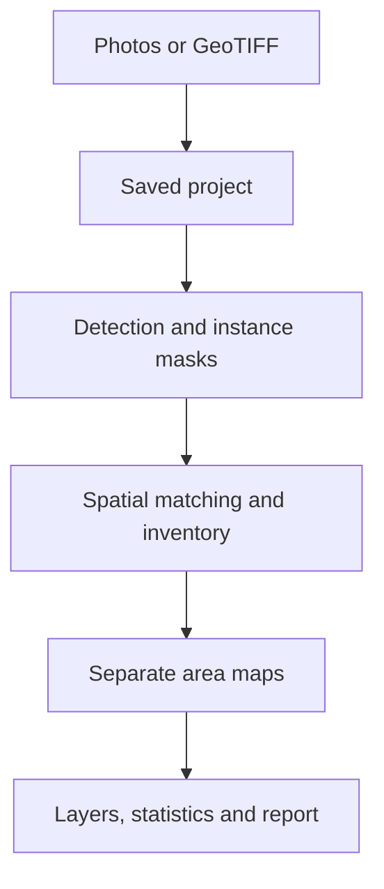

<div align="center">

# CrownTrace

**Oil Palm Crown Analysis · Computer Vision · WebGIS**

Analisis individu pohon kelapa sawit dari citra drone RGB, dengan segmentasi mahkota, estimasi jumlah pohon, indikasi kondisi visual, dan pemetaan interaktif.

`Python` · `PyTorch` · `GeoTIFF / GDAL` · `Local WebGIS` · `Research prototype`

</div>

## Overview

CrownTrace is a research prototype that transforms overhead oil-palm imagery into interpretable, per-tree information. It is designed around one research focus: crown instance segmentation, tree counting, and visual-condition screening, with spatial mapping as the presentation and validation layer.

### What it does

- **Individual crown segmentation** — delineates each predicted palm crown rather than a single vegetation region.
- **Inventory** — predicts counts and visual categories, with spatial reconciliation of compatible overlapping imagery.
- **Multi-image workspace** — one upload flow for photos and GeoTIFF, with saved projects, background processing, pause/resume, duplicate handling, and results by area.
- **Interactive maps** — toggle original imagery, crowns, points and photo coverage; inspect a prediction; save the rendered map or print an area report.
- **Research tooling** — preparation, training, grouped evaluation and regression utilities kept separate from the interface.

> [!IMPORTANT]
> **Source-only research release.** Trained checkpoints, raw/derived datasets, unpublished manuscript, private experiment outputs, and customer or job databases are not distributed through this public repository. A clone does not yet include the assets for live model inference. See [Data and models](docs/DATA_AND_MODELS.md). Counts are predictions; visual condition is not a confirmed disease diagnosis.

## Quick start

```powershell
python -m venv .venv
& .\.venv\Scripts\python.exe -m pip install -r requirements.txt
& .\.venv\Scripts\python.exe -m crowntrace.server --port 8767 --open-browser
```

Open [http://127.0.0.1:8767/](http://127.0.0.1:8767/). On the complete research computer, `Buka_Riset_WebGIS.cmd` starts the workspace directly. See [Quick start](docs/QUICKSTART.md) for compatible assets, GeoTIFF setup and usage.

## How it works



Photos are joined only when audited coordinates or verified image overlap support placement. Otherwise they remain separate; a relative mosaic is not an orthorectified geographic map. For geographic output, use a valid georeferenced GeoTIFF.

## Repository structure

| Directory | What it contains |
|---|---|
| [`crowntrace/`](crowntrace/) | Core CV, masks, inference, GIS, project storage, local APIs |
| [`web/`](web/) | Research workspace, map rendering, optional service portal |
| [`research/`](research/) | Data preparation, model training and evaluation scripts |
| [`tests/`](tests/) | Offline regression and interface-contract tests |
| [`docs/`](docs/) | Architecture, usage, data and model documentation |
| [`data/`](data/) | Data-layout documentation only |
| [`results/`](results/) | Local-artifact layout documentation only |
| `requirements*.txt` | Python dependencies and optional baseline stack |
| `Buka_Riset_WebGIS.cmd` | Windows research-workspace launcher |

## Documentation

| Guide | Purpose |
|---|---|
| [Quick start](docs/QUICKSTART.md) | Setup, run, use, test |
| [Architecture](docs/ARCHITECTURE.md) | Pipeline, modules and coordinate integrity |
| [Data and models](docs/DATA_AND_MODELS.md) | Dataset sources, local checkpoint layout and evaluation protocol |
| [Changelog](CHANGELOG.md) | Source-release changes |

## Research status

This is an ongoing research prototype. The experimental workspace has been exercised with multi-image workloads, mixed source imagery, and GeoTIFF, including a 120-image local example. These are functional tests, not proof of field accuracy or generalization. Independent crown masks and condition references are required to establish scientific conclusions. The optional service portal is not a production or payment service.

## Researcher

**Fijar Satria Pinandita Mangkauna** — Information Technology, Telkom University. The active research is focused on individual oil-palm crown segmentation and visual-condition screening.

## Rights and citation

Reference the original datasets according to their respective terms. This repository is a research source release; no additional open-source license grant is implied. Third-party font licenses are provided alongside their assets. The manuscript and model release remain separate until publication/redistribution rights are agreed.
