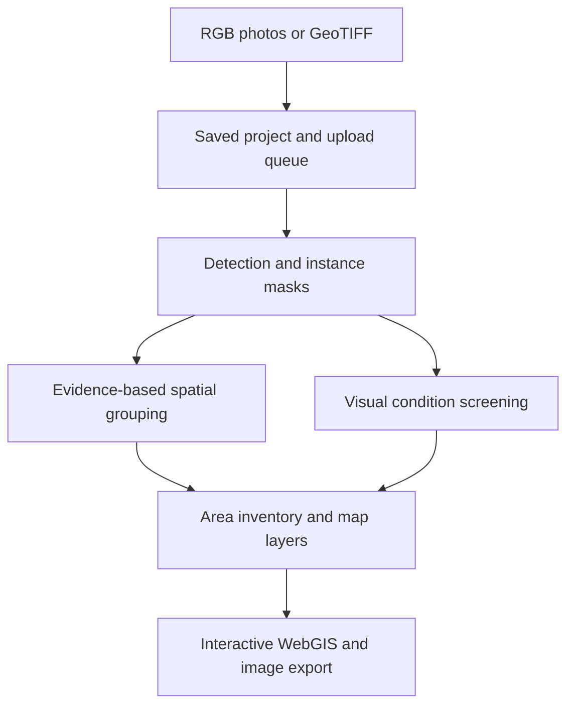

# Architecture

CrownTrace is a local research prototype for individual oil-palm crown analysis. The primary workspace is independent of the optional service portal.

## Components

| Path | Responsibility |
|---|---|
| `crowntrace/compact.py`, `inference.py` | Detector and windowed inference; prediction fusion. |
| `crowntrace/segment.py`, `photo.py` | Crown delineation and per-image inference. |
| `crowntrace/relative_registration.py`, `lab_batch_map.py` | Relative translation matching, verified groups, composited imagery and mask layers. |
| `crowntrace/survey.py`, `survey_api.py`, `raster_worker.py` | GeoTIFF processing and geographic exports through GDAL/QGIS. |
| `crowntrace/workspace_projects.py` | Durable upload, queue, deduplication, pause/resume and saved results. |
| `crowntrace/server.py`, `lab_segmentation.py` | Local research API. |
| `web/workspace.html`, `workspace_jobs.js`, `workspace.js`, `workspace.css` | Main research workspace, jobs and interactive layers. |
| `crowntrace/portal_*`, `web/portal/` | Optional local service-portal prototype; not a deployed payment or customer service. |
| `research/`, `tests/` | Data preparation, training/evaluation utilities and software regression tests. |

## Coordinate integrity

- Known source crops can use audited relative offsets. New photos are joined only when compatible same-scale overlap and pixel evidence support a translation; otherwise they remain separate.
- A relative mosaic is **not** an orthorectified geographic map. Rotation, perspective, elevation, and incompatible scales may require a separate photogrammetric pipeline.
- GeoTIFF mapping depends on the source CRS/geotransform. Verify them against survey control before claiming physical positioning or area accuracy.
- Never treat the sum of unrelated areas as a unique field census. Visual categories and inspection candidates are not confirmed disease diagnoses.

Local state is stored under `analyses/` and `portal_workspace/`; these directories are not part of the public source release.
